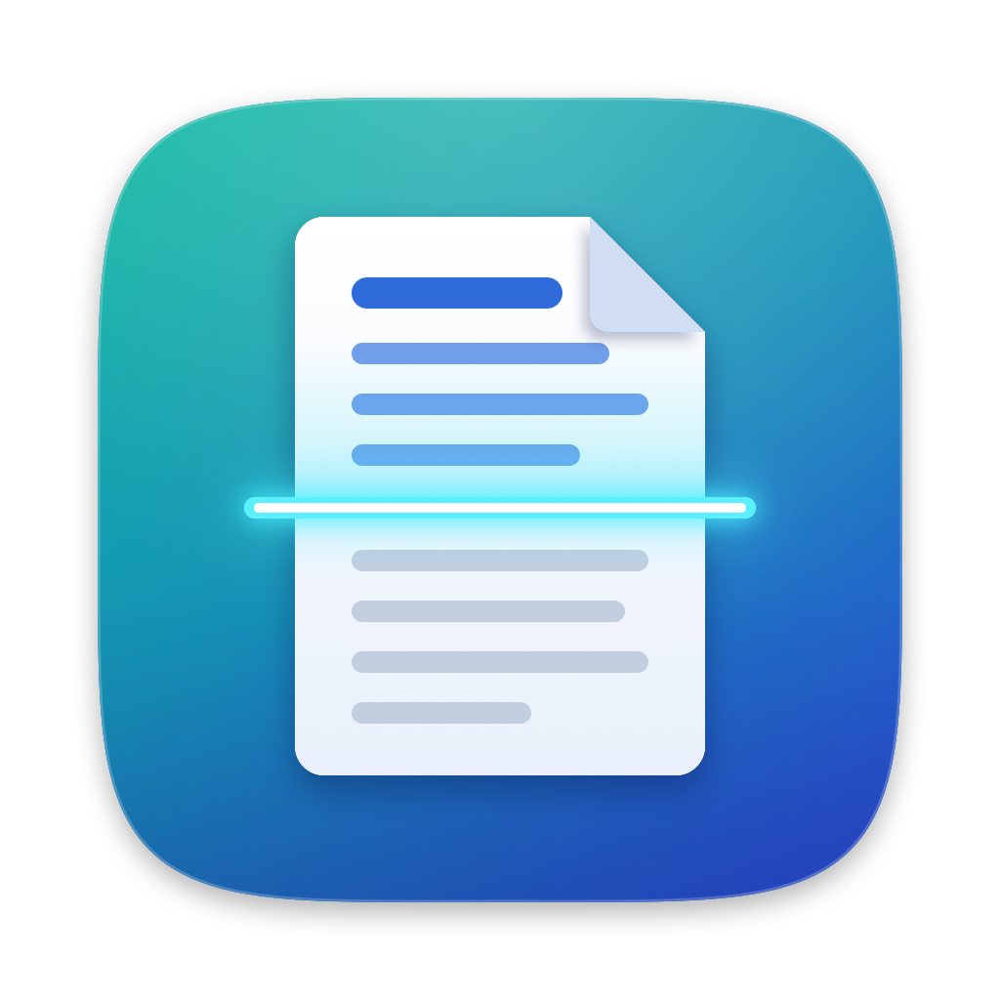
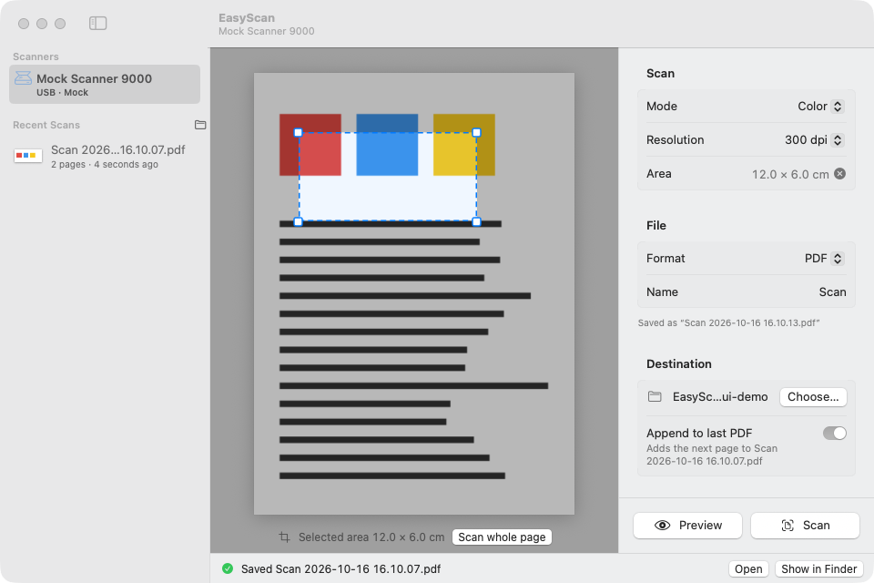
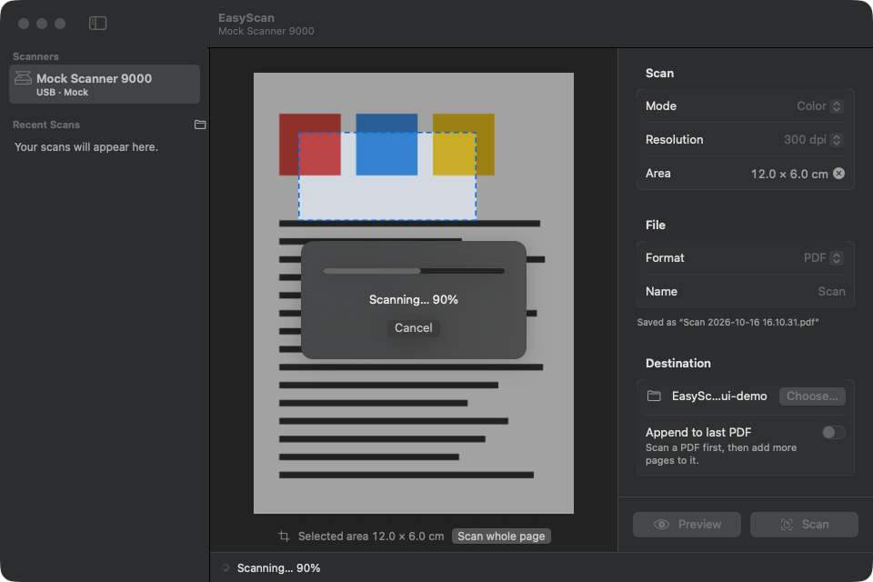
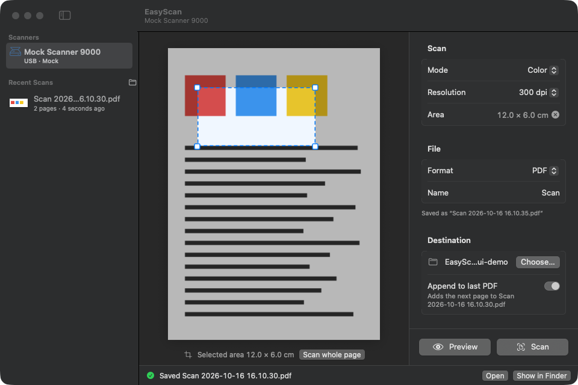
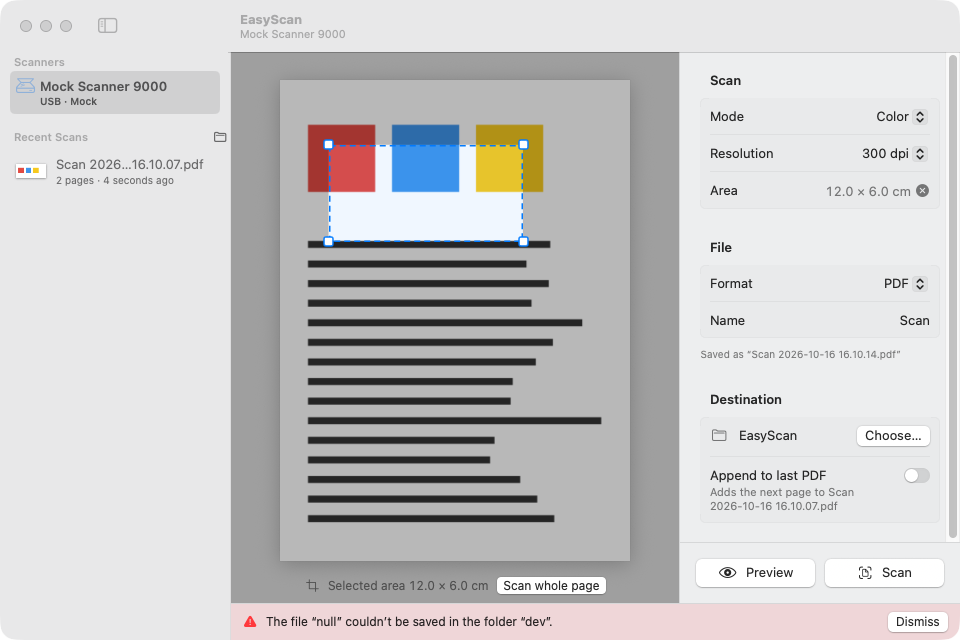
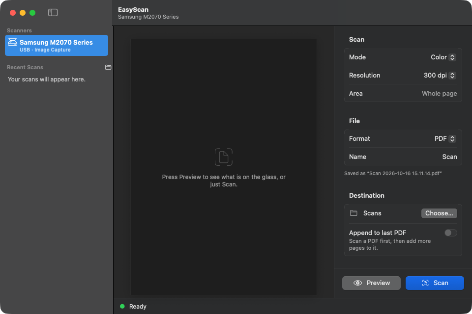

<p align="center">
  
</p>
<h1 align="center">EasyScan</h1>
<p align="center">A small native macOS scanner app that just scans. In color. Even after Rosetta is gone.</p>

<p align="center">
  
</p>

## Why this exists

I own a Samsung M2070, a laser all-in-one from 2014. It prints fine. Scanning has been a sad story for a decade:

- Apple's Image Capture has crashed on every **color** scan since roughly the "Mac OS X" to "macOS" rename. Black and white worked, so I lived with it.
- The macOS 27 upgrade warned that "some binaries will no longer work" and pointed at the printer driver. After installing Rosetta, Image Capture only said *Failed to open a connection to the device (-21345)*.
- Apple's scanner module for Samsung devices is a 2013 Intel binary signed with a certificate the system no longer trusts. It still runs under Rosetta, but [macOS 28 limits Rosetta to old games](https://developer.apple.com/news/?id=w5ngl9k2). The driver has a year to live.

Digging in showed two things. The dreaded -21345 was a one-off: macOS had tried to launch the driver nineteen seconds *before* Rosetta finished installing, and nothing ever retried. And the driver itself scans in color perfectly well when driven through Apple's `ImageCaptureCore` framework. Only the Image Capture app falls over.

So EasyScan does three things: it drives whatever scanner macOS can see through `ImageCaptureCore` directly, it falls back to [SANE](http://www.sane-project.org) (native, no vendor driver, keeps working after Rosetta), and it stays out of your way.

## What it does

- Scans a flatbed to **PDF, PNG, JPEG or TIFF** at any resolution the scanner offers, in color, grayscale or black & white.
- **Preview** the glass, then drag to select an area, move it, or resize it by the corners.
- **Multi-page PDFs**: flip "Append to last PDF" and every further scan becomes a new page.
- Keeps a list of recent scans with thumbnails. Double-click opens, drag to Finder or Mail.
- Files land in `~/Documents/Scans` (or any folder you choose), named with a timestamp, never overwriting anything.
- Keyboard: ⌘R scan, ⇧⌘P preview, ⌘. stop, ⇧⌘D choose folder.
- Two scanner engines. Apple's Image Capture driver stack is tried first. If nothing shows up within a few seconds, or you press *Look again*, SANE takes over.

## Screenshots

| Preview with a selected area | Scanning |
|---|---|
|  |  |

| Two pages appended to one PDF | Error handling |
|---|---|
|  |  |

The screenshots use a built-in mock scanner so the pages are synthetic. With the real printer attached it looks like this:

<p align="center"></p>

## Requirements

- macOS 14 or later. Builds as a native Apple Silicon app (an Intel build is a flag away).
- A scanner that Image Capture can see, **or** SANE: `brew install sane-backends`. The Samsung M2070 works with the `xerox_mfp` backend.
- To build: Xcode 16 or later (Swift 6 toolchain). No Xcode project; it is a plain SwiftPM package.

## Install

```sh
git clone https://github.com/svachmic/EasyScan.git
cd EasyScan
./build.sh --install --run
```

`build.sh` builds a release binary, assembles `EasyScan.app` with its icon and `Info.plist`, signs it ad hoc, and with `--install` places it in `~/Applications`.

If you would rather not build, each [release](https://github.com/svachmic/EasyScan/releases) has a zipped app attached. It is signed ad hoc, not notarized, so the first launch needs a right-click → Open (or `xattr -d com.apple.quarantine EasyScan.app`).

## How it works

```
SwiftUI views ──▶ ScanController ──▶ ScannerEngine (protocol)
                                        ├── ImageCaptureEngine   Apple ImageCaptureCore, in-process
                                        ├── SANEEngine           runs `scanimage` as a child process
                                        └── MockEngine           synthetic pages for UI work
```

- `ScanController` is the only object the UI talks to. It owns the settings, runs previews and scans, appends PDF pages with PDFKit, and keeps the recent list.
- `ImageCaptureEngine` bridges the delegate-based `ICScannerDevice` API to async/await. It carries a few hard-won workarounds: a scan requested inside `deviceDidBecomeReady` is silently dropped, so requests go out on a later run-loop turn; `measurementUnit` must be set before reading the glass size; a cancel produces two completions; restarting the device browser makes devices flap forever, so it is never restarted.
- `SANEEngine` discovers devices with `scanimage -L`, reads capabilities from `--help`, scans to PNG with `--progress`, trims the extra rows the backend pads on, and converts to the requested format. Discovery is one-shot on purpose: probing SANE opens the USB device and would disturb an Image Capture session.
- Only one session can be open on the Samsung driver. EasyScan releases its session after 60 seconds of inactivity so Image Capture and other apps can still reach the scanner.

## Troubleshooting

- **No scanner found.** Switch the scanner on, check the USB cable, press *Look again*. If macOS offers to install Rosetta for the vendor driver, accept and relaunch EasyScan.
- **"The scanner is in use by another app."** Quit Image Capture, Preview or a second EasyScan. SANE and the Image Capture driver cannot hold the device at the same time either.
- **Everything stopped after a macOS upgrade.** Vendor scanner modules are Intel-only. Install SANE (`brew install sane-backends`) and EasyScan will use it automatically.
- **Color scans crash Image Capture but work here.** Yes. That is the point.

## Development

```sh
swift build                                   # debug build
EASYSCAN_MOCK=1 .build/debug/EasyScan         # run against the synthetic scanner
EASYSCAN_UI_DEMO=1 EASYSCAN_MOCK=1 .build/debug/EasyScan   # scripted tour of every UI state (prints window ids for screencapture)
EASYSCAN_SELFTEST_DIR=/tmp/scans build/EasyScan.app/Contents/MacOS/EasyScan --selftest   # headless end-to-end run on real hardware
./build.sh --icon                             # regenerate the icon from Packaging/make-icon.swift
```

A command-line companion with the same engine logic lives in the story that started this: a 150-line Swift script was enough to prove the driver could scan in color.

## How it was built

In one afternoon with [Claude Code](https://claude.com/claude-code). The engine contract was written first, then four subagents built the Image Capture engine, the SANE engine, the SwiftUI interface and the packaging in parallel, each testing against the real scanner. A fifth agent reviewed the result; its findings about appending pages mid-scan and stale capability results were fixed before the first install. Every path you see here was exercised on an actual Samsung M2070 over USB.

## License

[BSD Zero Clause](LICENSE). Do what you like; no attribution required. SANE itself is GPL, but EasyScan only runs the `scanimage` executable you install yourself and does not ship or link it.
